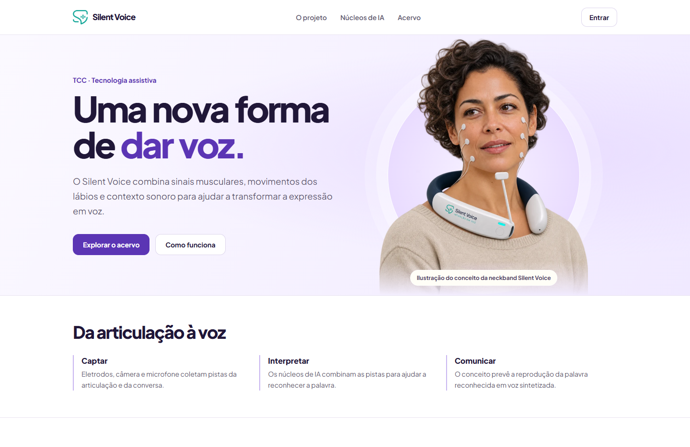
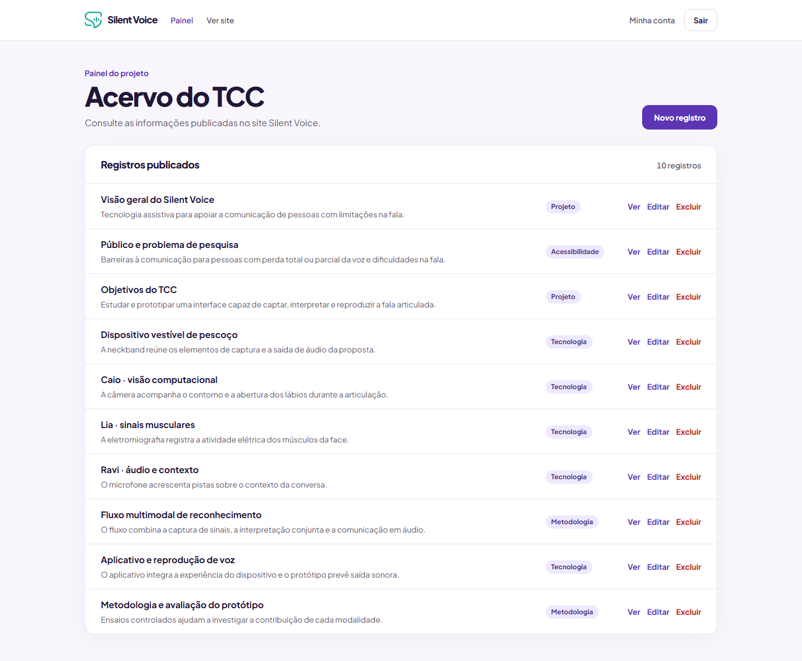
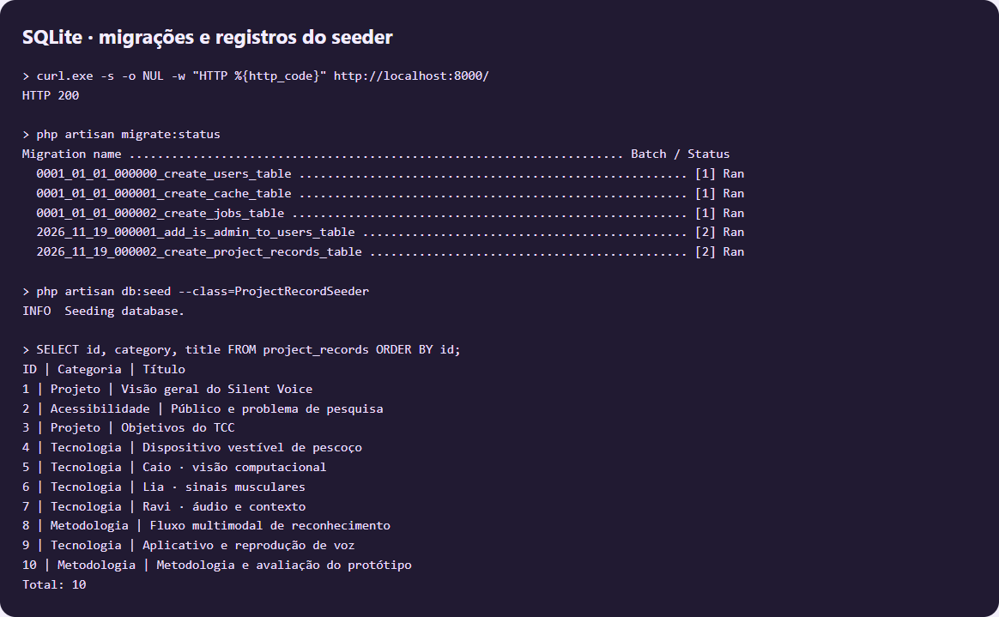
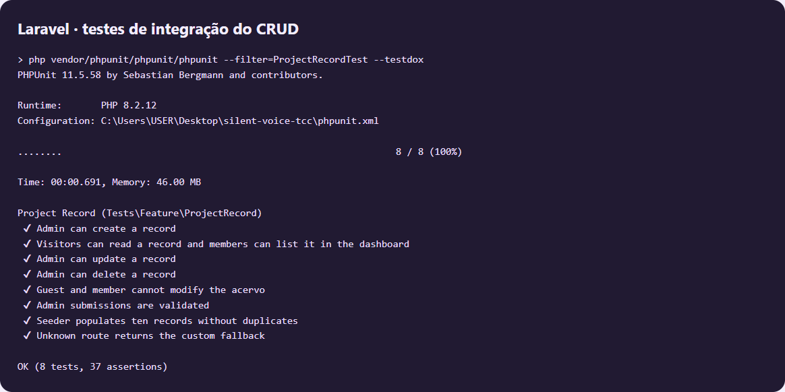

# Silent Voice TCC

Portal acadêmico do **Silent Voice**, um projeto de tecnologia assistiva para apoiar a comunicação de pessoas com perda total ou parcial da voz e dificuldades na fala. A proposta investiga como uma neckband pode combinar eletromiografia, movimentos dos lábios e contexto sonoro para ajudar a reconhecer palavras e reproduzi-las em voz sintetizada.

A página inicial explica a proposta e exibe o acervo do TCC. O painel usa a mesma base de dados e permite que administradores criem, consultem, editem e excluam registros. Cada registro tem título, categoria, resumo e conteúdo completo. Os dez registros iniciais cobrem o problema de pesquisa, o público, os objetivos, o dispositivo, os núcleos Caio, Lia e Ravi, o fluxo multimodal, o aplicativo e a avaliação do protótipo. O portal documenta a pesquisa e apresenta o conceito do dispositivo.

## Executar em localhost

Requisitos: **PHP 8.2+** com a extensão `pdo_sqlite`, **Composer 2**, **Node.js 22.12+** e **npm**. O SQLite roda em um arquivo local.

```bash
git clone https://github.com/andreiolicar/silent-voice-tcc.git
cd silent-voice-tcc
composer install
php -r "file_exists('.env') || copy('.env.example', '.env');"
php artisan key:generate
php -r "file_exists('database/database.sqlite') || touch('database/database.sqlite');"
php artisan migrate --seed
npm ci
npm run build
php artisan serve --host=localhost --port=8000
```

Acesse [http://localhost:8000](http://localhost:8000). Para editar o front-end com atualização automática, execute `npm run dev` em outro terminal com o servidor Laravel aberto. No PowerShell, use `npm.cmd` se a política local bloquear `npm.ps1`.

### Conta de demonstração

| Campo | Valor |
| --- | --- |
| E-mail | `admin@silentvoice.test` |
| Senha | `SilentVoice123!` |
| Ambiente | `APP_ENV=local` |

O seeder cria essa conta no ambiente local. O cadastro em `/register` cria uma conta comum com acesso de leitura ao painel. Para demonstrar a recuperação de senha com `MAIL_MAILER=log`, solicite o link em `/forgot-password` e abra a URL da última mensagem em `storage/logs/laravel.log`.

## Rotas e controle de acesso

| Método e rota | Função | Acesso |
| --- | --- | --- |
| `GET /` | Apresentação e lista do acervo | Público |
| `GET /acervo/{record}` | Consulta do conteúdo completo | Público |
| `GET /login`, `GET /register`, `GET /forgot-password` | Login, cadastro e solicitação de recuperação de senha no Breeze | Visitante |
| `GET /dashboard` | Painel com todos os registros | Usuário autenticado |
| `GET /painel/registros/novo` | Formulário de criação | Administrador |
| `POST /painel/registros` | Criar registro | Administrador |
| `GET /painel/registros/{record}/editar` | Formulário de edição | Administrador |
| `PATCH /painel/registros/{record}` | Atualizar registro | Administrador |
| `DELETE /painel/registros/{record}` | Excluir registro | Administrador |
| `GET /endereco-inexistente` | Exemplo de rota fallback com HTTP 404 | Público |

O middleware `auth` protege o painel e o perfil. O middleware `can:manage-records` protege os formulários e as operações de escrita. As rotas de autenticação do Breeze usam `guest` ou `auth` conforme a ação. Os formulários usam tokens CSRF.

## Banco de dados e back-end

- A migration de [usuários, redefinição de senha e sessões](database/migrations/0001_01_01_000000_create_users_table.php) vem da estrutura do Laravel. A migration de [permissão de administrador](database/migrations/2026_11_19_000001_add_is_admin_to_users_table.php) adiciona `is_admin`, cujo padrão é `false`.
- A migration de [registros do acervo](database/migrations/2026_11_19_000002_create_project_records_table.php) cria `project_records` com título único e carimbos de data. O [seeder](database/seeders/ProjectRecordSeeder.php) insere os dez registros iniciais e usa o título para identificar entradas que já existem.
- As [rotas](routes/web.php) ligam as ações de CRUD ao [controller](app/Http/Controllers/ProjectRecordController.php). O [Form Request](app/Http/Requests/ProjectRecordRequest.php) valida os dados e o [model Eloquent](app/Models/ProjectRecord.php) persiste os registros.
- Os [testes de integração](tests/Feature/ProjectRecordTest.php) verificam criação e atualização no SQLite, consulta pública e no painel, exclusão e resposta 404 após remoção, permissões, validação e seeder.

```bash
php artisan migrate:status
php artisan route:list -v
php artisan test
php artisan test --filter=ProjectRecordTest
```

## Prints em localhost

### Site e painel

Página inicial em `http://localhost:8000/`.



Painel em `http://localhost:8000/dashboard`, com os dez registros do acervo.



Outras telas: [Login](docs/prints/02-login.png) · [Acervo público](docs/prints/12-acervo-publico.png) · [Página inicial no celular](docs/prints/11-inicio-mobile.png).

### Front-end · operações do CRUD

| Operação | Print |
| --- | --- |
| **Criar** | [Formulário preenchido para publicar um registro](docs/prints/04-criar.png) |
| **Consultar** | [Registro recém-criado disponível no acervo público](docs/prints/05-consultar.png) |
| **Atualizar** | [Formulário com a revisão do registro](docs/prints/06-editar.png) |
| **Excluir** | [Caixa de confirmação](docs/prints/07-excluir.png) e [resultado após excluir](docs/prints/08-excluido.png) |

### SQLite · migrações e seeder



### Back-end · CRUD e testes de integração



## Referências

O acervo inicial e as imagens da neckband e dos três núcleos foram adaptados do [site oficial Silent Voice](https://www.silentvoice.com.br/) e de seu [repositório de origem](https://github.com/andreiolicar/silent-voice/tree/main/apps/site). A fonte Plus Jakarta Sans inclui a [licença OFL](resources/fonts/plus-jakarta-sans-OFL.txt). O portal usa [Laravel 12](https://laravel.com/docs/12.x), [Laravel Breeze](https://github.com/laravel/breeze), Blade, Tailwind CSS e SQLite.
